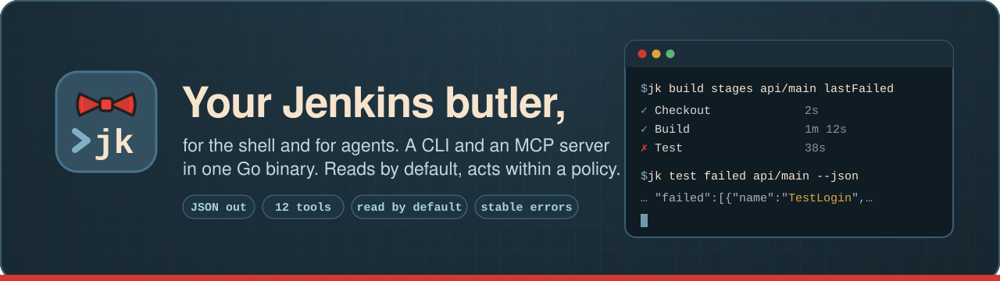

# jk

`jk` is an agent-first Jenkins® CLI and MCP server in one Go binary.

- **`jk`** is a CLI whose stdout carries only data (JSON when piped), and
  whose errors have stable codes and exit codes.
- **`jk mcp`** serves the same 12 operations as MCP tools over stdio.
- **A policy** in the config file decides what an agent may do: read only (the
  default), trigger and replay builds, or stop builds. Flags can only lower it.

<p align="center">
  
</p>

<p align="center">
  <a href="https://github.com/phuquocchamp/jk/releases"></a>
  <a href="https://github.com/phuquocchamp/jk/actions/workflows/ci.yml"></a>
  <a href="https://phuquocchamp.github.io/jk/"></a>
  <a href="go.mod"></a>
  <a href="LICENSE"></a>
</p>

<p align="center">
  <a href="#install">Install</a> ·
  <a href="#quick-start">Quick start</a> ·
  <a href="#tools">Tools</a> ·
  <a href="#policy">Policy</a> ·
  <a href="#use-with-claude-code-mcp">MCP</a> ·
  <a href="https://phuquocchamp.github.io/jk/">Docs</a>
</p>

## Install

```sh
go install github.com/phuquocchamp/jk/cmd/jk@latest
```

Or download a release archive for macOS, Linux or Windows (amd64 and arm64)
from the [releases page](https://github.com/phuquocchamp/jk/releases), verify
it against `checksums.txt`, and put `jk` on your `PATH`. Binaries are static
(`CGO_ENABLED=0`). From source: `make build` writes `bin/jk`.

Shell completion: `source <(jk completion zsh)` (or `bash`, `fish`,
`powershell`).

## Quick start

**1. Create an API token** in Jenkins: your user, then **Security**, then
**API Token**, then **Add new token**.

**2. Connect.** Pick one setup (don't mix them: exported `JENKINS_*` values
always win over the config file and keyring).

<table>
<tr><th>Config file + OS keyring (recommended)</th><th>Environment variables (CI, quick try)</th></tr>
<tr><td>

```sh
mkdir -p ~/.config/qtools
cat > ~/.config/qtools/jk.yaml <<'YAML'
profiles:
  default:
    url: https://jenkins.example.com
    user: jane
YAML
chmod 600 ~/.config/qtools/jk.yaml

jk auth login   # paste token at hidden prompt
```

</td><td>

```sh
export JENKINS_URL=https://jenkins.example.com
export JENKINS_USER=jane
export JENKINS_API_TOKEN=...   # never commit
```

</td></tr>
</table>

**3. Check it works**, then start reading builds:

```sh
jk auth status                                # token_source: keyring | env:JENKINS_API_TOKEN

jk job list team-a                            # jobs in a folder
jk build get team-a/api/main lastFailed       # what happened
jk build stages team-a/api/main lastFailed    # which stage failed
jk log tail team-a/api/main lastFailed --stage Test -n 200
jk log search team-a/api/main 57 -e '(?i)error' -C 3
jk test failed team-a/api/main lastFailed
```

A `<job>` is a path (`folder/sub/job`), a multibranch branch
(`project/branch`, with `/` in branch names written as `%2F`), or a pasted
Jenkins URL. A `[ref]` is a build number or `last` (default), `lastFailed`,
`lastSuccessful`, `lastCompleted`.

More: [getting started](https://phuquocchamp.github.io/jk/getting-started/),
[authentication](https://phuquocchamp.github.io/jk/authentication/),
[configuration and profiles](https://phuquocchamp.github.io/jk/configuration/).

## Tools

12 operations, each a CLI command and an MCP tool (`jenkins_` + name):
**9 read · 2 write · 1 danger**.

| Area | CLI | MCP tool | Tier |
|---|---|---|---|
| **Auth** | `auth status` | `jenkins_whoami` | read |
| **Jobs** | `job list [folder]` · `job get <job>` | `jenkins_job_list` · `jenkins_job_get` | read |
| **Builds** | `build get <job> [ref]` · `build stages <job> [ref]` | `jenkins_build_get` · `jenkins_build_stages` | read |
| | `build trigger <job> [-p k=v ...] [--wait]` · `build replay <job> <ref> --script-file F` | `jenkins_build_trigger` · `jenkins_build_replay` | write |
| | `build stop <job> <ref> [--yes]` | `jenkins_build_stop` | danger |
| **Logs** | `log tail <job> [ref] [-n N] [--stage NAME]` · `log search <job> [ref] -e RE` | `jenkins_build_log` · `jenkins_log_search` | read |
| **Tests** | `test failed <job> [ref]` | `jenkins_test_failed` | read |
| **Queue** | `queue get <id>` | `jenkins_queue_get` | read |

Global flags: `--json`, `--fields a,b`, `--jq EXPR`, `--profile NAME`,
`--tier`, `--dry-run`, `-y/--yes`. What each tool returns:
[Tools](https://phuquocchamp.github.io/jk/tools/). Every flag:
[CLI reference](https://phuquocchamp.github.io/jk/reference/jk/).

### Not supported

jk reads builds and runs a small set of build actions. It has **no** command
for: listing a job's build history, artifacts, approving Pipeline `input`
steps, cancelling queue items, creating or configuring jobs, agents/nodes,
credentials, plugins or views, file parameters on trigger, and MCP over HTTP
(stdio only). Replay sends the main Jenkinsfile only. Details and other limits:
[Tools → Not supported](https://phuquocchamp.github.io/jk/tools/#not-supported).

## Policy

```yaml
# ~/.config/qtools/jk.yaml
profiles:
  default:
    url: https://jenkins.example.com
    user: jane
    policy:
      tier: write                       # read | write | danger (default read)
      allow: { jobs: ["team-a/**"] }    # empty = all jobs
      deny:  { jobs: ["prod/**"] }      # deny wins over allow
```

- `read` (default) allows the 9 read tools; `write` adds trigger and replay;
  `danger` adds stop.
- `--tier` can only **lower** the configured tier. In MCP, tools above the tier
  are not registered at all.
- `build stop` needs `--yes` (MCP: `confirm: true`); without it jk exits 7 with
  the plan. Write operations accept `--dry-run`.
- **The tier is not a sandbox.** The real boundary is the Jenkins user's
  permissions. See [Policy](https://phuquocchamp.github.io/jk/policy/).

## Use with Claude Code (MCP)

```sh
claude mcp add jk -- jk mcp
claude mcp add jk -- jk mcp --tier read   # read-only even if the config allows more
```

Keep the token in the keyring or your shell environment, not in `.mcp.json`.
Tools appear as `mcp__jk__jenkins_*`. Desktop apps need the absolute path to
`jk` as `command`. More: [MCP server](https://phuquocchamp.github.io/jk/mcp/).

For agents that run shell commands, a Claude Code skill for the CLI is in
[`skills/jenkins/`](skills/jenkins/SKILL.md). Copy that folder to `~/.claude/skills/jenkins/`.

## Output and exit codes

Stdout is data only; errors go to stderr as
`{"error":{"code","message","hint","retryable","details"}}`.

| exit | code |
|---|---|
| 0 | success |
| 1 | `UPSTREAM`, `INTERNAL` |
| 2 | `USAGE` |
| 3 | `NOT_FOUND` |
| 4 | `POLICY_DENIED`, `FORBIDDEN` |
| 5 | `CONFLICT` |
| 6 | `AUTH_REQUIRED` |
| 7 | `NEEDS_CONFIRMATION` |

Meanings, retry rules, log truncation and spill files:
[Output and errors](https://phuquocchamp.github.io/jk/errors/).

## Security

- The token is never printed or logged. Requests are logged (at most) as
  method, path and status on stderr.
- Use a token for a Jenkins user with only the permissions the agent needs.
- Keep the config file private (`chmod 600`); jk warns otherwise.

## Development

```sh
make lint-lite   # gofmt check, go vet, go mod tidy -diff, kit import rule
make test        # go test ./...  (httptest only; never calls a real Jenkins)
make build       # bin/jk
make docs-serve  # regenerate the CLI reference and preview the docs site
```

Releasing: [docs/release.md](docs/release.md).

## License

MIT, see [LICENSE](LICENSE).

<sub>Jenkins® is a registered trademark of LF Charities Inc. jk is an
independent project, not affiliated with or endorsed by the Jenkins project.</sub>
