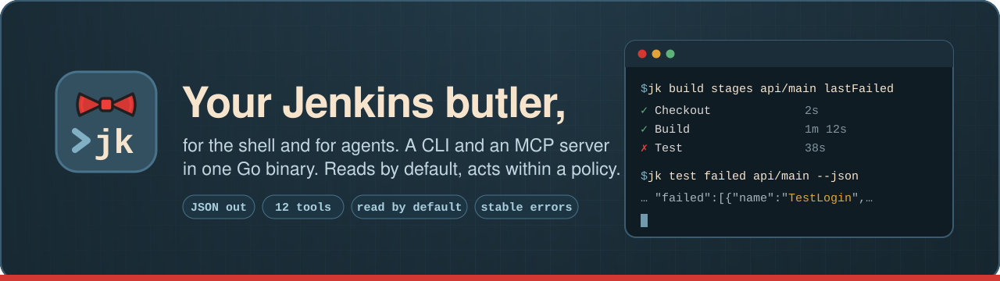

<p align="center">
  <a href="https://phuquocchamp.github.io/jk/">
    
  </a>
</p>

<p align="center">
  Read and drive Jenkins® from your terminal and from your coding agent.
</p>

<p align="center">
  <a href="https://github.com/phuquocchamp/jk/releases"></a>
  <a href="https://github.com/phuquocchamp/jk/actions/workflows/ci.yml"></a>
  <a href="https://phuquocchamp.github.io/jk/"></a>
  <a href="go.mod"></a>
  <a href="LICENSE"></a>
</p>

---

jk is a Jenkins CLI and MCP server in one Go binary. The CLI prints only data
on stdout (JSON when piped) and fails with stable error codes. `jk mcp` serves
the same 15 operations as MCP tools. A policy in your config decides what an
agent may do: read only (the default), trigger builds, or replay and stop them.

## Installation

```sh
# Install script (macOS, Linux): checks the download, installs to ~/.local/bin
curl -fsSL https://raw.githubusercontent.com/phuquocchamp/jk/main/install.sh | sh

# Go
go install github.com/phuquocchamp/jk/cmd/jk@latest

# Prebuilt binaries (macOS, Linux, Windows; amd64 and arm64)
# Download from GitHub Releases and verify against checksums.txt.

# From source
make build                 # writes bin/jk
```

Binaries are static (`CGO_ENABLED=0`). Archives are on the
[releases page](https://github.com/phuquocchamp/jk/releases).

Shell completion:

```sh
source <(jk completion zsh)   # or bash, fish, powershell
```

## Connect To Jenkins

Create an API token in Jenkins (your user → **Security** → **API Token** →
**Add new token**), then log in:

```sh
jk auth login          # asks for the URL, the user and the token
jk auth status         # token_source: keyring
```

`jk auth login` asks Jenkins who the token belongs to before saving anything,
so a mistyped token or URL is caught right there. When the check passes, jk:

- stores the token in macOS Keychain, Windows Credential Manager or the Linux
  Secret Service (service `jk`, account = profile name), and
- creates `~/.config/qtools/jk.yaml` (mode `0600`) with the URL, the user and
  policy tier **read**. The file holds no secret, and login never changes a
  profile that already exists.

In scripts: `printf %s "$TOKEN" | jk auth login --url https://jenkins.example.com --user jane --with-token`.

Working with several controllers? Pin a profile per repository with
`git config jk.profile legacy`; every jk command (and `jk mcp`) run in that
repository then uses it.

In CI, or where there is no keyring, use environment variables instead. An
exported `JENKINS_*` value always wins over the config file and the keyring:

```sh
export JENKINS_URL=https://jenkins.example.com
export JENKINS_USER=jane
export JENKINS_API_TOKEN=...   # never commit
```

Keep the user and the token in the same place. If the token is exported but
the user comes from `jk.yaml` (or the other way round), `jk auth status` warns
that the token may belong to another Jenkins user.

More: [authentication](https://phuquocchamp.github.io/jk/authentication/),
[configuration and profiles](https://phuquocchamp.github.io/jk/configuration/).

## Debug A Failed Build

Go from "it's red" to the failing stage, step, log lines and tests in one call:

```sh
jk build diagnose team-a/api/main                  # lastFailed by default
```

Or step by step:

```sh
jk build get    team-a/api/main lastFailed         # what happened
jk build stages team-a/api/main lastFailed         # which stage failed
jk log tail     team-a/api/main lastFailed --stage Test -n 200
jk log search   team-a/api/main 57 -e '(?i)error' -C 3
jk test failed  team-a/api/main lastFailed
```

A `<job>` is a path (`folder/sub/job`), a multibranch branch
(`project/branch`, with `/` in branch names written as `%2F`), or a pasted
Jenkins URL. A `[ref]` is a build number or `last` (default), `lastFailed`,
`lastSuccessful`, `lastCompleted`.

## Run Builds

Write and danger operations need a higher policy tier (see [Policy](#policy)):

```sh
jk build trigger team-a/api/main -p ENV=staging --wait
jk build replay  team-a/api/main 57 --script-file Jenkinsfile
jk build stop    team-a/api/main 58 --yes
jk build trigger team-a/api/main --dry-run         # show the plan, do nothing
```

## Use From An Agent

Register jk as an MCP server and install the skill:

```sh
jk setup mcp --tier read     # runs: claude mcp add jk -- /path/to/jk mcp --tier read
jk setup skill               # writes the jenkins skill to ~/.claude/skills/jenkins
```

Or by hand: `claude mcp add jk -- jk mcp --tier read`. For Claude Desktop,
Cursor and others, `jk setup mcp --client print` prints the JSON entry.

Danger tools (`build_replay`, `build_stop`) ask the user through MCP
elicitation when the client supports it, so the agent cannot approve its own
action. Waits stream progress and stop after 45s with a `next` call; results
over 64 KB are also served as `jk://spill/...` resources.

`jk mcp` resolves the token the same way the CLI does, so the keyring works
here too and the token never has to sit in `.mcp.json`. Don't add it with
`claude mcp add -e JENKINS_API_TOKEN=...`: Claude Code would save it in plain
text in its config. Tools appear as
`mcp__jk__jenkins_*`. Desktop apps need the absolute path to `jk` as
`command`. More: [MCP server](https://phuquocchamp.github.io/jk/mcp/).

For agents that run shell commands, the Claude Code skill for the CLI is in
[`skills/jenkins/`](skills/jenkins/SKILL.md); `jk setup skill` installs it.

## Tools

15 operations, each a CLI command and an MCP tool (`jenkins_` + name):
**12 read · 1 write · 2 danger**.

| Area | CLI | MCP tool | Tier |
|---|---|---|---|
| **Auth** | `auth status` | `jenkins_whoami` | read |
| **Jobs** | `job list [folder]` · `job get <job>` | `jenkins_job_list` · `jenkins_job_get` | read |
| **Builds** | `build diagnose <job> [ref]` | `jenkins_build_diagnose` | read |
| | `build get <job> [ref]` · `build stages <job> [ref]` | `jenkins_build_get` · `jenkins_build_stages` | read |
| | `build script <job> [ref]` · `build wait <job> [ref] [--queue-id N]` | `jenkins_build_replay_script` · `jenkins_build_wait` | read |
| | `build trigger <job> [-p k=v ...] [--wait]` | `jenkins_build_trigger` | write |
| | `build replay <job> <ref> --script-file F [--yes]` · `build stop <job> <ref> [--yes]` | `jenkins_build_replay` · `jenkins_build_stop` | danger |
| **Logs** | `log tail <job> [ref] [-n N] [--stage NAME]` · `log search <job> [ref] -e RE` | `jenkins_build_log` · `jenkins_log_search` | read |
| **Tests** | `test failed <job> [ref]` | `jenkins_test_failed` | read |
| **Queue** | `queue get <id>` | `jenkins_queue_get` | read |

Global flags: `--json`, `--fields a,b`, `--jq EXPR`, `--profile NAME`,
`--tier`, `--dry-run`, `-y/--yes`.

jk has **no** command for build history, artifacts, Pipeline `input`
approval, cancelling queue items, job/agent/credential/plugin configuration,
file parameters, or MCP over HTTP (stdio only). Replay sends the main
Jenkinsfile only. See [Tools → Not supported](https://phuquocchamp.github.io/jk/tools/#not-supported).

## Policy

```yaml
# ~/.config/qtools/jk.yaml
profiles:
  default:
    url: https://jenkins.example.com
    user: jane
    policy:
      tier: write                       # read | write | danger (default read)
      allow: { jobs: ["team-a/**"] }    # empty = all jobs
      deny:  { jobs: ["prod/**"] }      # deny wins over allow
```

- `read` (default) allows the 12 read tools; `write` adds trigger;
  `danger` adds replay (it runs arbitrary pipeline code) and stop.
- `--tier` can only **lower** the configured tier. In MCP, tools above the
  tier are not registered at all.
- `build stop` and `build replay` need `--yes` (MCP: `confirm: true`); without
  it jk exits 7 with the plan (for replay, a diff against the original script). Write operations accept `--dry-run`.
- **The tier is not a sandbox.** The real boundary is the Jenkins user's
  permissions. See [Policy](https://phuquocchamp.github.io/jk/policy/).

## Output And Exit Codes

Stdout is data only. Errors go to stderr as
`{"error":{"code","message","hint","retryable","details"}}`.

| exit | code |
|---|---|
| 0 | success |
| 1 | `UPSTREAM`, `INTERNAL` |
| 2 | `USAGE` |
| 3 | `NOT_FOUND` |
| 4 | `POLICY_DENIED`, `FORBIDDEN` |
| 5 | `CONFLICT` |
| 6 | `AUTH_REQUIRED` |
| 7 | `NEEDS_CONFIRMATION` |

Meanings, retry rules, log truncation and spill files:
[Output and errors](https://phuquocchamp.github.io/jk/errors/).

## Reference

Use `--help` on any command to explore flags and examples:

```sh
jk build --help
jk log search --help
```

- [CLI reference](https://phuquocchamp.github.io/jk/reference/jk/)
- [Getting started](https://phuquocchamp.github.io/jk/getting-started/)
- [Tools](https://phuquocchamp.github.io/jk/tools/)
- [jk docs](https://phuquocchamp.github.io/jk/)

## Security

- The token is never printed or logged. Requests are logged (at most) as
  method, path and status on stderr.
- Use a token for a Jenkins user with only the permissions the agent needs.
- Keep the config file private (`chmod 600`); jk warns otherwise.

## Developing

```sh
make lint-lite   # gofmt check, go vet, go mod tidy -diff, kit import rule
make test        # go test ./...  (httptest only; never calls a real Jenkins)
make build       # bin/jk
make docs-serve  # regenerate the CLI reference and preview the docs site
```

| Path | Purpose |
|---|---|
| `cmd/jk` | Binary entry point |
| `internal/cli` | Cobra commands |
| `internal/core` | The 15 operations, shared by CLI and MCP |
| `internal/client` | Jenkins HTTP client |
| `internal/mcpserver` | `jk mcp` tool registration |
| `internal/kit` | Shared building blocks: auth (keyring), config, policy, errors, output |
| `skills/jenkins` | Claude Code skill for the CLI |
| `docs` | Astro Starlight site |

Releasing: `make release BUMP=minor`, then push the tag; see [docs/src/content/docs/release.md](docs/src/content/docs/release.md).

## Contributing

Focused pull requests with a clear problem and tests that match the
user-facing behaviour are welcome. Run `make lint-lite` and `make test` before
opening one. PR titles use conventional commits, for example:

```text
fix(log): keep stage filter when the log is truncated
```

## License

jk is released under the MIT license. See [LICENSE](LICENSE).

<sub>Jenkins® is a registered trademark of LF Charities Inc. jk is an
independent project, not affiliated with or endorsed by the Jenkins project.</sub>
