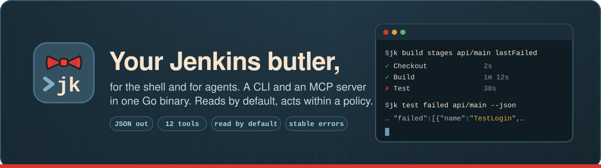

---
hide:
  - navigation
---

# jk



`jk` is an agent-first Jenkins® CLI and MCP server in one Go binary.

- **`jk ...`** is a CLI whose stdout carries only data (JSON when piped), and
  whose errors have stable codes and exit codes.
- **`jk mcp`** serves the same 12 operations as MCP tools over stdio.
- **A policy** in the config file decides what an agent may do: read only
  (the default), trigger and replay builds, or stop builds. Flags can only
  lower it.

It talks to Jenkins over its REST API with a user API token. No Jenkins plugin
is needed beyond the usual Pipeline ones (`pipeline-rest-api` for stages and
stage logs, `junit` for test reports).

```sh
go install github.com/phuquocchamp/jk/cmd/jk@latest
export JENKINS_URL=https://jenkins.example.com JENKINS_USER=jane
printf %s "$TOKEN" | jk auth login --with-token
jk build stages team-a/api/main lastFailed
```

## Where to go next

| I want to… | Read |
|---|---|
| Install jk and run a first command | [Getting started](getting-started.md) |
| Store the API token | [Authentication](authentication.md) |
| Set up profiles and the config file | [Configuration](configuration.md) |
| Decide what an agent may do | [Policy](policy.md) |
| See every tool, and what jk does not do | [Tools](tools.md) |
| Connect Claude Code or another MCP client | [MCP server](mcp.md) |
| Parse output and handle errors | [Output and errors](errors.md) |
| Look up one command's flags | [CLI reference](reference/jk.md) |

---

<small>Jenkins® is a registered trademark of LF Charities Inc. jk is an
independent project, not affiliated with or endorsed by the Jenkins project.</small>
